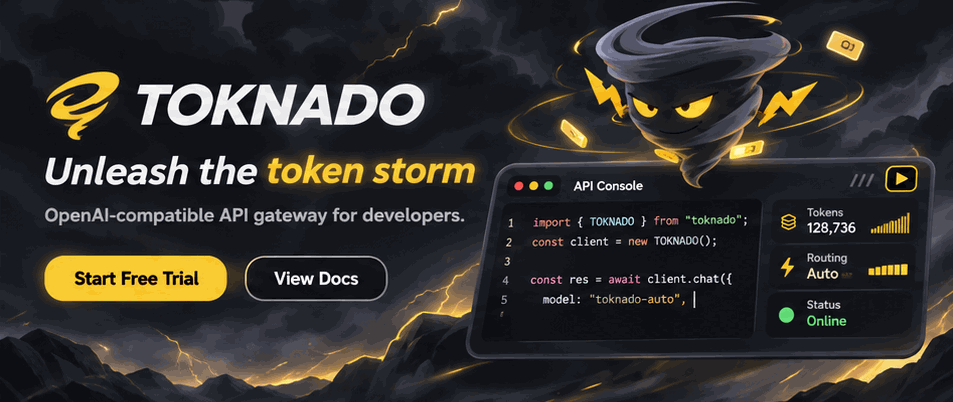

# TOKNADO



TOKNADO is an OpenAI-compatible AI gateway with a local Storm Console for loading and monitoring HTTP proxies. It starts with zero proxies. Use **Start the storm** to load the configured proxy list, then monitor capacity, usage, and proxy health from the dashboard.

## Get started

Install Node.js 22.13 or newer, then run:

```sh
npm ci
npm start
```

Open the dashboard URL printed by the process. The default local endpoint is `http://127.0.0.1:43817/v1`.

Set your client to the endpoint above, use the API key printed by the launcher, and select `toknado/auto`. The gateway supports model discovery and OpenAI-compatible chat completions, including streaming and tool calls.

## Configuration

Useful environment variables include `PORT`, `HOST`, `API_AUTH_TOKEN`, `PROXY_STATE_FILE`, `PROXY_REQUESTS_PER_HOUR`, `PROXY_RETRIES`, and `PROXY_BACKOFF_SECONDS`.

The dashboard shows rolling hourly capacity, proxy availability, and lifetime token totals. Proxy lists are loaded only for the active session. Review and trust any proxy provider before loading its entries, since proxy servers carry your traffic.

## Releases

The GitHub Actions workflow creates Windows, Linux, and macOS release packages from a `v*` tag. Release artifacts use the TOKNADO name and include the required Node runtime.
